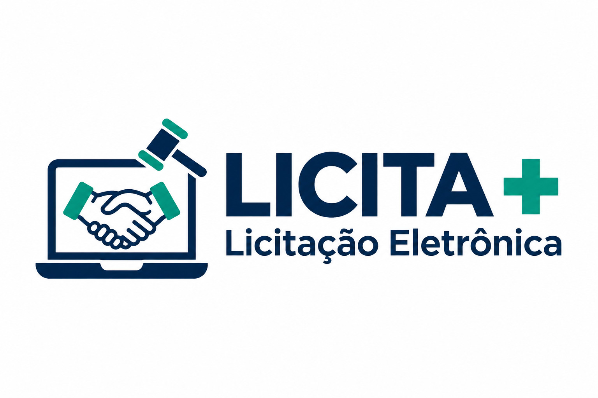

<p align="center">
  
</p>
# Licita+

Trabalho de Engenharia de Software Seguro sobre um sistema de licitações eletrônicas.

## Laboratório web

Com o Docker Desktop aberto, execute na raiz do repositório:

```sh
docker compose up -d --build
```

- [Ambiente vulnerável](http://127.0.0.1:3000).
- [Ambiente corrigido](http://127.0.0.1:3001).

Use `ana@alfa.test` com a senha `Alfa@123456`. A tela de login apresenta as demais contas fictícias.

O laboratório compara SQL injection, XSS armazenado e autorização por objeto. Os containers usam bancos e cookies distintos. As portas são publicadas somente em `127.0.0.1`.

- [Instalação, contas, testes e restauração dos dados](laboratorio/README.md).
- [Passo a passo da verificação manual com o ZAP](docs/Etapa-5-Verificacao-Vulnerabilidades.md).

## Documentação do trabalho

- [Etapa 1: ameaças STRIDE](docs/Etapa-1-Ameacas-SRIDE.md). Diagrama: [visão geral do sistema](diagramas/etapa-1/diagram.jpeg).
- [Etapa 2: riscos e tratamento com NIST CSF](docs/Etapa-2-Riscos-NIST.md).
- [Etapa 3: arquitetura segura proposta](docs/Etapa-3-Arquitetura-Segura.md).
- [Etapa 4: código seguro e testes de segurança](docs/Etapa-4-Codigo-Seguro.md). Demonstração em Python: [Dev/licita_seguro.py](Dev/licita_seguro.py).
- [Etapa 5: procedimento de verificação](docs/Etapa-5-Verificacao-Vulnerabilidades.md). Relatório e capturas: [evidencias/etapa-5/relatorio-da-verificacao.md](evidencias/etapa-5/relatorio-da-verificacao.md).
- [Etapa 6: monitoramento e detecção de intrusões](roteiros/etapa-6-deteccao-de-intrusoes.md).
- [Etapa 7: pipeline DevSecOps](docs/Etapa-7-DevSecOps.md).

O relatório da Etapa 5 reúne o que foi observado na sessão. Os testes automatizados do laboratório não substituem essa evidência.
