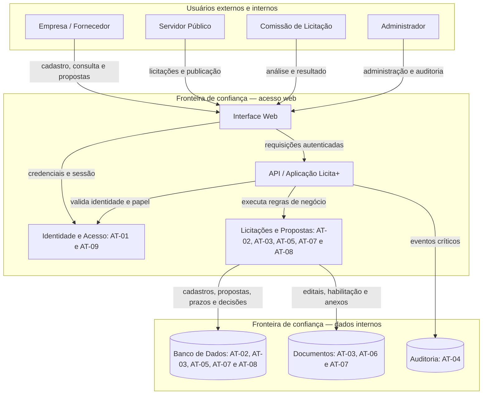

# ETAPA 1 — Casos de Abuso e Modelagem de Ameaças com STRIDE

## Sistema de Licitações Eletrônicas - Licita+

## 1. Identificação do sistema

| Item | Informação |
|---|---|
| **Nome do sistema** | Licita+ |
| **Integrantes do grupo** | Giovanna Evangelista, João Vitor, Leonardo Espindola Pires, Max Ziller |
| **Repositório** | https://github.com/JvitorA/esof-seguro-licita |
| **Etapa** | Etapa 1 — Casos de Abuso e Modelagem de Ameaças com STRIDE |

### 1.1 Justificativa da escolha

O Sistema de Licitações Eletrônicas Licita+ foi escolhido após votação entre os integrandes do grupo. Na ocasião, após verificação de todas as sugestões dadas pelo professor, o integrante João Vitor comentou que trabalha com um sistema de licitações e sugeriu como uma alternativa aos demais sistemas. Alguns requisitos essenciais foram mencionados para reforçar que esse tipo de sistema se enquadra perfeitamente no objetivo da disciplina, como segurança, transparência e rastreabilidade.

Por tratar-se de um sistema que possui diferentes perfis de acesso, recebe documentos e propostas comerciais, mantém informações sigilosas e registra decisões, o grupo entendeu que tais características tornam o sistema adequado para a identificação de casos de abuso e, consequentemente, favorece a construção das categorias de ameaças do modelo STRIDE.

## 2. Descrição do sistema

### 2.1 Problema e objetivo

O Licita+ é uma plataforma web hipotética destinada a apoiar eletronicamente o ciclo de uma licitação. Seu objetivo é centralizar o cadastro de fornecedores, a publicação de editais, o recebimento sigiloso de propostas, a análise documental, a definição do vencedor, a publicação do resultado e a auditoria das operações relevantes.

O sistema reduz a dependência de procedimentos manuais e permite que empresas participem remotamente. Ao mesmo tempo, precisa garantir que somente usuários autorizados executem cada operação, que as propostas permaneçam confidenciais até o encerramento do prazo e que as ações realizadas possam ser posteriormente comprovadas. Ademais, deve-se garantir que todo o processo seja auditado, se necessário.

### 2.2 Escopo funcional

As principais funcionalidades consideradas nesta análise são:

1. cadastro da empresa, de seus representantes, documentos de habilitação e dados bancários;
2. autenticação de fornecedores, servidores públicos, membros da comissão e administradores;
3. cadastro e publicação de licitações, incluindo edital, requisitos, prazos e valor estimado;
4. consulta às licitações publicadas;
5. envio, alteração ou retirada de proposta enquanto o prazo estiver aberto;
6. manutenção do sigilo das propostas até o encerramento do prazo;
7. análise das propostas pela Comissão de Licitação;
8. definição e publicação do vencedor e da justificativa;
9. registro e consulta de logs de auditoria.

### 2.3 Informações armazenadas ou transmitidas

O sistema manipula:

- credenciais e informações de autenticação;
- dados cadastrais das empresas e de seus representantes;
- documentos de habilitação;
- dados bancários dos fornecedores;
- editais e documentos complementares;
- prazos, requisitos e valores estimados;
- propostas comerciais e seus anexos;
- datas e horários de submissão, alteração e retirada;
- avaliações e decisões da Comissão de Licitação;
- identificação do vencedor e justificativa do resultado;
- registros de acesso e de auditoria.

## 3. Usuários, ativos e pontos de interação

### 3.1 Usuários e perfis de acesso

| Ator | Responsabilidades e acessos legítimos | Restrições principais |
|---|---|---|
| **Empresa/Fornecedor** | Cadastrar empresa e representantes; consultar licitações; enviar, alterar ou retirar sua própria proposta no prazo permitido | Não pode acessar dados privados ou propostas de concorrentes, nem funções administrativas |
| **Servidor Público** | Cadastrar e publicar licitações e, quando autorizado, publicar resultados | Não pode consultar antecipadamente propostas sigilosas nem modificar decisões reservadas à comissão |
| **Comissão de Licitação** | Acessar propostas após o prazo; analisar documentos; definir o vencedor e justificar a decisão | Não pode liberar propostas antes do prazo nem apagar o histórico da análise |
| **Administrador do Sistema** | Administrar a plataforma e consultar auditoria quando autorizado | Não deve decidir o resultado da licitação nem alterar silenciosamente registros de negócio ou auditoria |
| **Atacante externo** | Não possui acesso legítimo | Pode tentar explorar autenticação, autorização, upload de arquivos ou disponibilidade |
| **Usuário interno mal-intencionado** | Possui algum acesso legítimo, mas tenta ultrapassar suas atribuições | Representa ameaça interna e pode abusar de informações ou privilégios já concedidos |

### 3.2 Ativos importantes

| ID | Ativo | Por que precisa ser protegido | Propriedades prioritárias |
|---|---|---|---|
| AT-01 | Contas e credenciais | Permitem autenticar usuários e agir em nome de empresas ou agentes públicos | Confidencialidade, integridade e autenticidade |
| AT-02 | Cadastro de empresas | Identifica empresas, representantes e dados cadastrais necessários à participação | Confidencialidade e integridade |
| AT-03 | Propostas comerciais | Contêm valores, condições, anexos e registros de envio que sustentam a disputa | Confidencialidade, integridade e disponibilidade |
| AT-04 | Logs de auditoria | Permitem atribuir ações, investigar incidentes e demonstrar a regularidade do processo | Integridade, disponibilidade e não repúdio |
| AT-05 | Dados bancários | Podem ser utilizados em fraudes ou causar prejuízo financeiro caso sejam expostos ou alterados | Confidencialidade e integridade |
| AT-06 | Documentos de habilitação | Comprovam a aptidão do fornecedor e podem conter dados empresariais ou pessoais restritos | Confidencialidade, integridade e disponibilidade |
| AT-07 | Editais, requisitos e prazos | Definem as regras, condições, documentos exigidos e limites temporais da licitação | Integridade, disponibilidade e autenticidade |
| AT-08 | Resultado e justificativa | Materializam a decisão da comissão e a fundamentação da escolha do vencedor | Integridade, autenticidade e disponibilidade |
| AT-09 | Perfis e permissões | Determinam quais dados e operações cada usuário pode acessar | Integridade |

Os ativos mais críticos são as propostas ainda sigilosas (AT-03), os logs de auditoria (AT-04), os documentos de habilitação (AT-06), os editais, requisitos e prazos (AT-07), o resultado e sua justificativa (AT-08) e os perfis e permissões (AT-09). O comprometimento desses elementos pode afetar diretamente a isonomia, a legalidade, a rastreabilidade e a confiança no processo licitatório.

Itens como Banco de dados, repositório de documentos, aplicação/API, infraestrutura e relógio do servidor são relevantes para a segurança, mas não são tratados como ativos. Nesse caso, passam a ser componentes técnicos que armazenam, processam ou transportam os nove ativos.

### 3.3 Pontos de interação e superfícies de ataque

| Ponto de interação | Ativos envolvidos | Dados/ações envolvidos | Riscos de interesse |
|---|---|---|---|
| Tela de cadastro | AT-01, AT-02, AT-05 e AT-06 | Credenciais, dados empresariais, representantes, dados bancários e documentos | Identidade falsa, adulteração e exposição de dados |
| Tela de login e gestão de sessão | AT-01 e AT-09 | Credenciais, autenticação, recuperação de acesso e associação do perfil | Roubo de conta, tentativa automatizada e uso indevido de permissões |
| Área do servidor público | AT-07, AT-08 e AT-09 | Cadastro de edital, definição de prazo, publicação e divulgação do resultado | Alteração indevida, publicação irregular e abuso de privilégio |
| Consulta pública ou autenticada | AT-07 e AT-08 | Consulta a editais, prazos e resultados | Exposição excessiva, coleta automatizada e indisponibilidade |
| Área de propostas | AT-03, AT-04 e AT-09 | Envio, alteração, retirada, consulta de estado e registro temporal | Acesso antecipado, alteração indevida, fraude e repúdio |
| Upload e download de arquivos | AT-03, AT-06 e AT-07 | Anexos de propostas, documentos de habilitação e editais | Arquivo malicioso, adulteração e acesso direto não autorizado |
| Área da comissão | AT-03, AT-06, AT-08 e AT-09 | Abertura, análise e decisão sobre propostas e documentos | Acesso antes do prazo, alteração do resultado e abuso de permissão |
| Área administrativa | AT-01, AT-04 e AT-09 | Gestão de contas, perfis, permissões e consulta à auditoria | Elevação de privilégio e destruição de evidências |
| API da aplicação | AT-01 a AT-09 | Operações expostas pelo servidor e fluxos entre interface e serviços internos | Falha de autorização, manipulação de parâmetros e abuso de volume |
| Banco de dados e armazenamento | AT-02 a AT-08 | Persistência de registros e arquivos | Vazamento, adulteração, exclusão e indisponibilidade |
| Serviço de auditoria | AT-01, AT-04 e AT-09 | Registro da identidade, ação, objeto, resultado e horário | Repúdio, ocultação, alteração ou interrupção dos registros |

## 4. Visão geral da arquitetura e do fluxo

### 4.1 Componentes conceituais

Esta arquitetura é uma representação lógica simplificada, criada apenas para apoiar a modelagem de ameaças. Ela não define tecnologias de implementação. Os nove ativos são distribuídos entre os componentes que os processam ou armazenam; por isso, um componente técnico pode conter vários ativos sem se tornar um novo item do inventário.

| Componente | Responsabilidade | Ativos principais tratados |
|---|---|---|
| **Interface Web** | Receber requisições dos usuários e apresentar as funções permitidas | Pode interagir com AT-01 a AT-09, conforme o perfil |
| **API/Aplicação Licita+** | Aplicar regras do negócio, validar entradas e coordenar os demais componentes | AT-01 a AT-09 |
| **Serviço de Identidade e Acesso** | Autenticar usuários, manter sessões e verificar papéis e permissões | AT-01 e AT-09 |
| **Módulo de Licitações e Propostas** | Gerenciar cadastros, editais, prazos, propostas, análises e resultados | AT-02, AT-03, AT-05, AT-07 e AT-08 |
| **Banco de Dados** | Armazenar cadastros, metadados, estados e decisões | AT-02, AT-03, AT-05, AT-07 e AT-08 |
| **Repositório de Documentos** | Armazenar editais, documentos de habilitação e anexos de propostas | AT-03, AT-06 e AT-07 |
| **Serviço de Auditoria** | Registrar eventos críticos em local protegido e consultável | AT-01, AT-04 e AT-09 |

### 4.2 Diagrama de contexto e fluxo simplificado

### 4.3 Fluxo principal da licitação

1. O servidor público cadastra a licitação, define prazo e requisitos e envia o edital.
2. Depois da publicação, fornecedores consultam as condições e preparam suas propostas.
3. Durante o prazo aberto, cada fornecedor pode enviar, alterar ou retirar apenas a própria proposta.
4. O sistema mantém os conteúdos das propostas inacessíveis aos concorrentes, aos servidores e à comissão durante esse período.
5. O encerramento é determinado pelo horário oficial do servidor. A partir desse evento, alterações são bloqueadas e a comissão passa a ter acesso às propostas.
6. A comissão analisa valores e documentos, registra suas decisões, define o vencedor e apresenta uma justificativa.
7. O resultado é publicado por usuário autorizado.
8. Operações relevantes são registradas na trilha de auditoria com identidade, ação, objeto, data, horário e resultado da operação.

### 4.4 Fronteiras de confiança

Foram consideradas duas fronteiras principais. A primeira separa os dispositivos e navegadores dos usuários da aplicação. Todo dado recebido nessa fronteira deve ser tratado como não confiável. A segunda separa a aplicação dos serviços internos de persistência e auditoria. O acesso a esses serviços deve ocorrer somente por identidades de serviço autorizadas e por operações estritamente necessárias.

## 5. Modelagem de ameaças com STRIDE

### 5.1 Método adotado

O STRIDE foi aplicado aos atores, aos pontos de interação, aos fluxos e aos ativos descritos anteriormente. Cada ameaça representa uma situação concreta no sistema e é identificada com a letra "T" (referente à palavra Threat - ameaça em inglês) seguida de um identificador numérico (Ex: T-01, ameaça 01 identificada no STRIDE). Os identificadores serão mantidos nas etapas posteriores do trabalho para permitir a transformação das ameaças em riscos, conforme verificado na aula sobre o NIST CSF 2.0.

### 5.2 Ameaças identificadas

| ID | Categoria STRIDE | Componente ou ativo | Ameaça identificada | Possível impacto | Casos de abuso |
|---|---|---|---|---|---|
| T-01 | **Spoofing** | Contas e login (AT-01) | Atacante utiliza credenciais roubadas para se passar por fornecedor e enviar, alterar ou retirar uma proposta | Fraude, perda financeira, desclassificação da vítima e quebra da autenticidade | CA-03, CA-04 |
| T-02 | **Spoofing** | Contas de agentes públicos (AT-01) | Atacante assume a identidade de servidor, membro da comissão ou administrador | Publicação indevida, acesso a propostas, manipulação do resultado ou comprometimento da auditoria | CA-04, CA-07, CA-10 |
| T-03 | **Spoofing** | Cadastro de fornecedor (AT-02) | Pessoa cria ou controla cadastro empresarial com identidade ou representação falsa | Participação irregular e prática de atos em nome de terceiro | CA-08 |
| T-04 | **Tampering** | Propostas comerciais (AT-03) | Usuário altera valor, anexo, estado ou titularidade da proposta de outro fornecedor | Fraude, favorecimento e comprometimento da igualdade da disputa | CA-02 |
| T-05 | **Tampering** | Editais, requisitos e prazos (AT-07) | Usuário modifica regras ou prazo depois da publicação sem autorização ou histórico verificável | Direcionamento da licitação, tratamento desigual e contestações | CA-05 |
| T-06 | **Tampering** | Documentos de habilitação (AT-06) | Documento é falsificado, substituído, corrompido ou excluído | Habilitação ou desclassificação indevida e perda de evidência | CA-06, CA-08 |
| T-07 | **Tampering** | Resultado e justificativa (AT-08) | Vencedor, pontuação, análise ou justificativa é alterado sem autorização | Fraude direta, prejuízo ao erário e invalidação do processo | CA-07 |
| T-08 | **Tampering** | Logs de auditoria (AT-04) | Usuário privilegiado apaga ou modifica eventos para ocultar uma ação | Perda de rastreabilidade e dificuldade de responsabilização | CA-10 |
| T-09 | **Repudiation** | Propostas e logs (AT-03, AT-04) | Fornecedor nega ter enviado, alterado ou retirado uma proposta | Disputa sobre autoria, validade e tempestividade da operação | CA-03, CA-10 |
| T-10 | **Repudiation** | Resultado e logs (AT-08, AT-04) | Membro da comissão nega uma avaliação ou decisão por falta de registro confiável | Contestação do resultado e impossibilidade de atribuir responsabilidade | CA-07, CA-10 |
| T-11 | **Repudiation** | Editais, permissões e logs (AT-07, AT-09, AT-04) | Servidor ou administrador nega ter alterado prazo, permissão ou publicação | Ocultação de abuso e fragilidade da prestação de contas | CA-05, CA-10 |
| T-12 | **Information Disclosure** | Propostas comerciais (AT-03) | Proposta é acessada antes do encerramento do prazo por falha de autorização ou abuso interno | Vantagem competitiva indevida e quebra da isonomia | CA-01 |
| T-13 | **Information Disclosure** | Cadastro e dados bancários (AT-02, AT-05) | Usuário consulta dados de outra empresa por referência direta, consulta excessiva ou permissão incorreta | Violação de privacidade, fraude e dano reputacional | CA-09 |
| T-14 | **Information Disclosure** | Documentos de habilitação (AT-06) | Arquivos privados ficam acessíveis por endereço previsível, configuração incorreta ou resposta indevida da API | Vazamento de documentos empresariais e dados pessoais | CA-09 |
| T-15 | **Information Disclosure** | Contas, logs e respostas da aplicação (AT-01, AT-04) | Logs, erros ou respostas da aplicação revelam credenciais, identificadores, dados pessoais ou detalhes internos | Facilitação de novos ataques e exposição de informações | CA-04, CA-09 |
| T-16 | **Denial of Service** | API e ativos disponibilizados (AT-03, AT-07, AT-08) | Grande volume de requisições esgota os recursos do serviço, sobretudo próximo ao prazo final | Fornecedores legítimos não conseguem consultar o edital, enviar propostas ou acessar o resultado | CA-11 |
| T-17 | **Denial of Service** | Persistência de propostas e documentos (AT-03, AT-06, AT-07) | Consultas abusivas, exclusões ou consumo de armazenamento impedem acesso aos dados | Interrupção da licitação e perda temporária ou permanente de informações | CA-06, CA-11 |
| T-18 | **Denial of Service** | Prazos da licitação (AT-07) | Falha, indisponibilidade ou manipulação do mecanismo oficial de tempo impede validar corretamente o prazo | Aceitação tardia ou rejeição indevida de propostas legítimas | CA-11 |
| T-19 | **Elevation of Privilege** | Papéis e permissões (AT-09) | Fornecedor ou servidor explora falha de autorização e obtém perfil de comissão ou administrador | Acesso a dados sigilosos e execução de funções críticas | CA-05 |
| T-20 | **Elevation of Privilege** | API e perfis de acesso (AT-09) | Usuário chama diretamente operação administrativa que a interface oculta, sem verificação no servidor | Manipulação de licitações, propostas, permissões ou resultados | CA-02, CA-05, CA-07 |
| T-21 | **Elevation of Privilege** | Upload de documentos e permissões (AT-06, AT-07, AT-09) | Arquivo malicioso explora o processamento no servidor ou a abertura pela comissão | Comprometimento do servidor ou da estação de trabalho e expansão do acesso | CA-12 |

### 5.3 Síntese por categoria

| Categoria | Questão de segurança aplicada ao Licita+ | Ameaças |
|---|---|---|
| Spoofing | Alguém pode agir com a identidade de outro fornecedor ou agente público? | T-01 a T-03 |
| Tampering | Dados, arquivos, prazos, propostas, resultados ou registros podem ser modificados? | T-04 a T-08 |
| Repudiation | Uma ação relevante pode ser negada sem que existam evidências confiáveis? | T-09 a T-11 |
| Information Disclosure | Informações sigilosas ou privadas podem ser vistas por quem não deveria? | T-12 a T-15 |
| Denial of Service | Um ataque ou falha pode impedir a participação dentro do prazo? | T-16 a T-18 |
| Elevation of Privilege | Um usuário pode obter ou exercer permissões superiores às autorizadas? | T-19 a T-21 |

## 6. Casos de abuso

Os casos representam as formas pelas quais uma pessoa mal-intencionada, um usuário indevido ou até mesmo um usuário legítimo pode utilizar o sistema para causar danos.

### CA-01 — Acessar proposta antes do prazo

**Ator malicioso:** servidor público, membro da comissão ou outro usuário mal-intencionado.

**Objetivo:** conhecer antecipadamente valores ou condições de uma proposta para obter ou conceder vantagem competitiva.

**Condições necessárias:** existir falha no controle de autorização, erro na regra temporal, exposição de arquivo ou privilégio interno excessivo.

**Fluxo de abuso:**

1. O agente identifica uma licitação com prazo ainda aberto.
2. Tenta consultar diretamente o registro ou arquivo de uma proposta submetida.
3. O sistema deixa de validar conjuntamente o papel do usuário e o encerramento do prazo.
4. O conteúdo sigiloso é apresentado ou transferido ao agente.
5. A informação pode ser usada para favorecer determinado concorrente.

**Impacto:** quebra da confidencialidade, perda de isonomia, contestação ou anulação do processo e dano à confiança no sistema.

**Categorias STRIDE:** Information Disclosure e Elevation of Privilege.

**Ameaças relacionadas:** T-12 e T-19.

**Ativos afetados:** propostas comerciais (AT-03) e perfis e permissões (AT-09).

**Casos de uso afetados:** UC-06, UC-08 e UC-09.

### CA-02 — Alterar proposta de outra empresa

**Ator malicioso:** fornecedor, usuário interno ou atacante com acesso não autorizado.

**Objetivo:** prejudicar um concorrente ou modificar sua oferta para influenciar o resultado.

**Condições necessárias:** falha na verificação de propriedade da proposta, autorização baseada apenas na interface ou comprometimento de conta privilegiada.

**Fluxo de abuso:**

1. O agente autentica-se ou utiliza uma sessão comprometida.
2. Identifica a referência de uma proposta pertencente a outro fornecedor.
3. Solicita alteração de valor, documento ou estado da proposta.
4. A aplicação processa a operação sem confirmar a titularidade e as permissões.
5. A proposta adulterada passa a ser considerada pelo sistema.

**Impacto:** fraude, desclassificação indevida, favorecimento de concorrente e perda de integridade do processo.

**Categorias STRIDE:** Tampering e Elevation of Privilege.

**Ameaças relacionadas:** T-04 e T-20.

**Ativos afetados:** propostas comerciais (AT-03), logs de auditoria (AT-04) e perfis e permissões (AT-09).

**Casos de uso afetados:** UC-06, UC-07 e UC-09.

### CA-03 — Enviar proposta em nome de outra empresa

**Ator malicioso:** atacante em posse de credenciais, token ou sessão de um fornecedor.

**Objetivo:** cadastrar, substituir ou retirar uma proposta como se fosse a empresa vítima.

**Condições necessárias:** comprometimento da autenticação ou da sessão e ausência de confirmação adicional para operações críticas.

**Fluxo de abuso:**

1. O atacante obtém acesso à conta do fornecedor.
2. Entra no sistema utilizando a identidade da vítima.
3. Seleciona uma licitação e envia, altera ou retira uma proposta.
4. O sistema atribui a operação à conta legítima comprometida.
5. Posteriormente, surge disputa sobre a autoria da ação.

**Impacto:** fraude, prejuízo à empresa, proposta inválida, repúdio da operação e possível responsabilização indevida.

**Categorias STRIDE:** Spoofing, Tampering e Repudiation.

**Ameaças relacionadas:** T-01 e T-09.

**Ativos afetados:** contas e credenciais (AT-01), propostas comerciais (AT-03) e logs de auditoria (AT-04).

**Casos de uso afetados:** UC-02, UC-06 e UC-07.

### CA-04 — Roubar credenciais de usuário

**Ator malicioso:** atacante externo ou usuário mal-intencionado.

**Objetivo:** assumir uma conta e utilizar as funções ou informações associadas ao perfil da vítima.

**Condições necessárias:** credencial exposta, senha fraca ou reutilizada, página falsa, tentativa automatizada bem-sucedida ou token de sessão desprotegido.

**Fluxo de abuso:**

1. O agente tenta obter credenciais ou uma sessão válida de um usuário.
2. Usa o material obtido no ponto de autenticação.
3. O sistema reconhece o agente como a vítima.
4. O agente acessa dados ou realiza operações disponíveis para aquele perfil.

**Impacto:** acesso não autorizado, fraude, vazamento de dados e comprometimento de outras funções do processo.

**Categorias STRIDE:** Spoofing e Information Disclosure.

**Ameaças relacionadas:** T-01, T-02 e T-15.

**Ativos afetados:** contas e credenciais (AT-01) e perfis e permissões (AT-09), além dos ativos acessíveis pelo perfil comprometido.

**Casos de uso afetados:** UC-02 e todos os casos acessíveis pelo perfil comprometido.

### CA-05 — Elevar privilégios

**Ator malicioso:** usuário autenticado com permissões limitadas.

**Objetivo:** obter ou exercer permissões de servidor, comissão ou administrador.

**Condições necessárias:** falha na autorização do servidor, atribuição indevida de papel ou operação administrativa exposta sem validação suficiente.

**Fluxo de abuso:**

1. O usuário legítimo identifica uma função não prevista para seu perfil.
2. Envia uma requisição direta para a operação protegida ou tenta alterar seu papel.
3. A aplicação verifica apenas a autenticação, mas não a autorização necessária.
4. O usuário passa a acessar dados ou executar ações privilegiadas.

**Impacto:** acesso a propostas sigilosas, modificação de resultado, alteração de permissões ou destruição de evidências.

**Categorias STRIDE:** Elevation of Privilege e Tampering.

**Ameaças relacionadas:** T-19 e T-20.

**Ativos afetados:** perfis e permissões (AT-09), podendo alcançar propostas (AT-03), logs (AT-04), editais (AT-07) e resultados (AT-08).

**Casos de uso afetados:** UC-03, UC-04 e UC-08 a UC-12.

### CA-06 — Excluir documentos ou propostas

**Ator malicioso:** usuário interno, fornecedor ou atacante com acesso não autorizado.

**Objetivo:** eliminar informação necessária para prejudicar participantes, ocultar evidências ou interromper a análise.

**Condições necessárias:** autorização inadequada, acesso indevido ao armazenamento, ausência de proteção contra exclusão ou comprometimento de conta privilegiada.

**Fluxo de abuso:**

1. O agente localiza uma proposta ou documento relevante.
2. Solicita a exclusão ou utiliza acesso indevido ao repositório.
3. O sistema não impede a operação nem preserva versão recuperável.
4. O registro deixa de estar disponível para consulta ou análise.

**Impacto:** desclassificação indevida, indisponibilidade, perda de evidência e necessidade de interromper ou refazer o processo.

**Categorias STRIDE:** Tampering e Denial of Service.

**Ameaças relacionadas:** T-06 e T-17.

**Ativos afetados:** propostas comerciais (AT-03), documentos de habilitação (AT-06) e editais (AT-07).

**Casos de uso afetados:** UC-03, UC-06, UC-07 e UC-09.

### CA-07 — Modificar o resultado da licitação

**Ator malicioso:** usuário interno ou atacante que controla conta privilegiada.

**Objetivo:** indicar vencedor diferente, alterar avaliação ou justificar fraudulentamente a decisão.

**Condições necessárias:** acesso indevido às funções da comissão, segregação de funções insuficiente ou ausência de histórico verificável das decisões.

**Fluxo de abuso:**

1. O agente obtém acesso à área de análise ou resultado.
2. Altera avaliação, vencedor ou justificativa.
3. O sistema aceita a mudança sem autorização apropriada ou validação adicional.
4. O resultado adulterado é armazenado ou publicado.
5. O agente tenta negar ou ocultar a alteração.

**Impacto:** fraude, favorecimento indevido, prejuízo administrativo e financeiro, contestação e possível anulação da licitação.

**Categorias STRIDE:** Tampering, Repudiation e Elevation of Privilege.

**Ameaças relacionadas:** T-07, T-10 e T-20.

**Ativos afetados:** logs de auditoria (AT-04), resultado e justificativa (AT-08) e perfis e permissões (AT-09).

**Casos de uso afetados:** UC-09, UC-10 e UC-11.

### CA-08 — Cadastrar documentos ou informações falsas

**Ator malicioso:** empresa ou representante mal-intencionado.

**Objetivo:** aparentar atendimento aos requisitos para participar ou ser habilitado irregularmente.

**Condições necessárias:** validação insuficiente da identidade, representação ou autenticidade dos documentos apresentados.

**Fluxo de abuso:**

1. O agente cria ou utiliza um cadastro de fornecedor.
2. Informa dados falsos ou envia documento adulterado.
3. O sistema aceita o conteúdo sem validação suficiente.
4. A empresa participa ou avança no processo com base em informação inválida.

**Impacto:** habilitação irregular, fraude, seleção inadequada e invalidação do processo.

**Categorias STRIDE:** Spoofing e Tampering.

**Ameaças relacionadas:** T-03 e T-06.

**Ativos afetados:** cadastro de empresas (AT-02) e documentos de habilitação (AT-06).

**Casos de uso afetados:** UC-01, UC-06 e UC-09.

### CA-09 — Acessar dados de outras empresas

**Ator malicioso:** fornecedor ou outro usuário autenticado.

**Objetivo:** obter dados cadastrais, bancários ou documentos privados de terceiros.

**Condições necessárias:** falha de autorização por objeto, consulta excessivamente ampla, arquivo exposto ou permissão configurada incorretamente.

**Fluxo de abuso:**

1. O agente acessa uma função ou arquivo permitido para sua própria empresa.
2. Modifica a referência do objeto ou realiza consulta não prevista.
3. O sistema não verifica o vínculo entre o usuário e a empresa solicitada.
4. Dados ou documentos do terceiro são retornados.

**Impacto:** quebra de confidencialidade, fraude, dano reputacional e possível responsabilização administrativa ou jurídica.

**Categorias STRIDE:** Information Disclosure e Elevation of Privilege.

**Ameaças relacionadas:** T-13, T-14 e T-20.

**Ativos afetados:** cadastro de empresas (AT-02), dados bancários (AT-05), documentos de habilitação (AT-06) e perfis e permissões (AT-09).

**Casos de uso afetados:** UC-01, UC-05, UC-06 e UC-09.

### CA-10 — Apagar ou alterar logs

**Ator malicioso:** administrador ou usuário privilegiado mal-intencionado.

**Objetivo:** ocultar ações próprias ou de terceiros e impedir a responsabilização.

**Condições necessárias:** permissões excessivas sobre a auditoria, armazenamento sem proteção contra alteração ou ausência de cópia independente.

**Fluxo de abuso:**

1. O agente realiza ou identifica uma ação irregular.
2. Acessa os registros correspondentes com privilégio elevado.
3. Remove, altera ou interrompe a geração dos eventos.
4. Consultas posteriores deixam de apresentar evidência íntegra da ação.

**Impacto:** perda de rastreabilidade, repúdio plausível, investigação prejudicada e redução da confiança no sistema.

**Categorias STRIDE:** Tampering e Repudiation.

**Ameaças relacionadas:** T-08 a T-11.

**Ativos afetados:** logs de auditoria (AT-04).

**Casos de uso afetados:** UC-12 e todos os casos que geram eventos de auditoria.

### CA-11 — Sobrecarregar o sistema

**Ator malicioso:** atacante externo, fornecedor desonesto ou grupo de atacantes.

**Objetivo:** impedir ou degradar o acesso, especialmente próximo ao encerramento do prazo.

**Condições necessárias:** capacidade de gerar volume suficiente de requisições ou explorar uma operação de alto consumo sem limitação adequada.

**Fluxo de abuso:**

1. O agente escolhe uma função pública ou autenticada que consome recursos.
2. Gera grande quantidade de acessos ou operações simultâneas.
3. A aplicação, o banco ou o armazenamento ficam saturados.
4. Usuários legítimos enfrentam lentidão, erros ou indisponibilidade.
5. Algumas empresas não conseguem enviar a proposta dentro do prazo.

**Impacto:** indisponibilidade, participação desigual, perda de prazo, interrupção e contestação da licitação.

**Categorias STRIDE:** Denial of Service.

**Ameaças relacionadas:** T-16 a T-18.

**Ativos afetados:** propostas comerciais (AT-03), documentos de habilitação (AT-06), editais, requisitos e prazos (AT-07) e resultado (AT-08).

**Casos de uso afetados:** UC-02, UC-05, UC-06, UC-07 e UC-11.

### CA-12 — Enviar arquivo malicioso

**Ator malicioso:** fornecedor ou usuário com acesso à função de upload.

**Objetivo:** comprometer o processamento do servidor ou o dispositivo de quem analisa o arquivo.

**Condições necessárias:** validação insuficiente do arquivo, processamento inseguro ou abertura do conteúdo sem isolamento adequado.

**Fluxo de abuso:**

1. O agente prepara um arquivo que aparenta ser um documento aceito.
2. Envia o arquivo no cadastro, na proposta ou em outra função de anexação.
3. O sistema armazena ou processa o conteúdo sem controles suficientes.
4. O arquivo afeta o serviço ou o ambiente usado por quem o consulta.
5. O agente tenta ampliar o acesso obtido ou interromper operações.

**Impacto:** comprometimento de servidor ou estação, vazamento ou alteração de dados e indisponibilidade.

**Categorias STRIDE:** Elevation of Privilege, Tampering e Denial of Service.

**Ameaças relacionadas:** T-21, T-06 e T-17.

**Ativos afetados:** propostas comerciais (AT-03), documentos de habilitação (AT-06), editais (AT-07) e perfis e permissões (AT-09).

**Casos de uso afetados:** UC-01, UC-03, UC-06 e UC-09.

## 7. Matriz de rastreabilidade

A matriz demonstra que os casos de abuso derivam de funcionalidades concretas e estão vinculados às ameaças STRIDE e aos nove ativos definidos pelo grupo.

| Caso de abuso | Ativos principais | Casos de uso relacionados | Ameaças STRIDE relacionadas |
|---|---|---|---|
| CA-01 — Acesso antecipado à proposta | AT-03, AT-09 | UC-06, UC-08, UC-09 | T-12, T-19 |
| CA-02 — Alteração de proposta alheia | AT-03, AT-04, AT-09 | UC-06, UC-07, UC-09 | T-04, T-20 |
| CA-03 — Proposta em nome de terceiro | AT-01, AT-03, AT-04 | UC-02, UC-06, UC-07 | T-01, T-09 |
| CA-04 — Roubo de credenciais | AT-01, AT-09 | UC-02 e funções do perfil comprometido | T-01, T-02, T-15 |
| CA-05 — Elevação de privilégios | AT-09 e ativos alcançados pelo novo perfil | UC-03, UC-04, UC-08 a UC-12 | T-19, T-20 |
| CA-06 — Exclusão de documentos/propostas | AT-03, AT-06, AT-07 | UC-03, UC-06, UC-07, UC-09 | T-06, T-17 |
| CA-07 — Modificação do resultado | AT-04, AT-08, AT-09 | UC-09, UC-10, UC-11 | T-07, T-10, T-20 |
| CA-08 — Documentação falsa | AT-02, AT-06 | UC-01, UC-06, UC-09 | T-03, T-06 |
| CA-09 — Acesso a dados de terceiros | AT-02, AT-05, AT-06, AT-09 | UC-01, UC-05, UC-06, UC-09 | T-13, T-14, T-20 |
| CA-10 — Alteração de logs | AT-04 | UC-12 e operações auditadas | T-08, T-09, T-10, T-11 |
| CA-11 — Sobrecarga do sistema | AT-03, AT-06, AT-07, AT-08 | UC-02, UC-05, UC-06, UC-07, UC-11 | T-16, T-17, T-18 |
| CA-12 — Arquivo malicioso | AT-03, AT-06, AT-07, AT-09 | UC-01, UC-03, UC-06, UC-09 | T-06, T-17, T-21 |

## 8. Considerações finais

A licitação é um processo formal da administração pública realizado para garantir a transparência nas compras de produtos e contratações de serviços. Por esse motivo, consideramos que as ameaças mais preocupantes estão ligadas à quebra do sigilo das propostas, na alteração de propostas ou do resultado.

Os ativos mais importantes são as propostas comerciais (AT-03), os logs de auditoria (AT-04), os documentos de habilitação (AT-06), os editais, requisitos e prazos (AT-07), o resultado e a justificativa (AT-08) e os perfis e permissões (AT-09). 

Os casos de abuso CA-01 (acesso antecipado à proposta), CA-03 (operação em nome de outra empresa), CA-07 (modificação do resultado), CA-10 (alteração de logs) e CA-11 (sobrecarga do sistema) foram identificados como os maiores causadores de impacto para o sistema Licita+.

O primeiro desafio que destacamos é a falta de conhecimento prévio e aprofundado sobre o domínio. Mesmo que um dos integrantes trabalhe com sistemas de licitação, as possibilidades e situações são inúmeras. A definição das ameaças pelo STRIDE não foi uma tarefa simples para o grupo, visto que algumas situações são semelhantes e dificultam a sua identificação. Por fim, a conexão do caso de abuso com as ameaças relacionadas, os ativos afetados e os casos de uso impôs certa dificuldade, visto que um caso de abuso pode ter várias ramificações, ou seja, estar ligado em mais de um elemento (ameaças, ativos, uso, etc.).