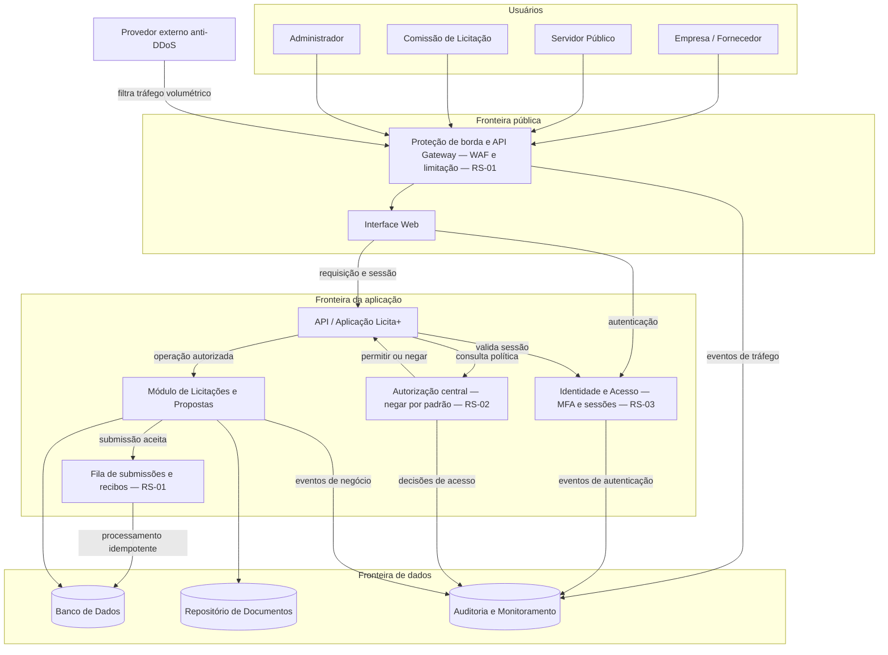

# ETAPA 3 — Projeto de uma Arquitetura Segura

## Sistema de Licitações Eletrônicas — Licita+

## 1. Objetivo

Esta etapa transforma riscos e controles definidos nas Etapas 1 e 2 em requisitos de segurança e decisões de arquitetura para o Licita+. A proposta é descritiva e apresenta como o sistema deverá ser organizado para reduzir três riscos críticos selecionados conforme a priorização já realizada.

## 2. Riscos selecionados

| Prioridade | Risco | Pontuação | Motivo da seleção |
|---:|---|---:|---|
| 1 | **R-11 — Indisponibilidade no prazo final** | 16 — Crítico | Possui a maior pontuação e pode impedir simultaneamente vários fornecedores de participar |
| 2 | **R-05 — Elevação ou abuso de privilégios** | 12 — Crítico | Uma falha de autorização pode alcançar propostas, prazos, resultados, permissões e logs |
| 3 | **R-04 — Comprometimento de credenciais** | 12 — Crítico | Uma conta comprometida pode iniciar diversos outros eventos de risco e permitir ações em nome da vítima |

Os três riscos correspondem às três primeiras posições da priorização da Etapa 2 e atingem ativos centrais identificados na Etapa 1: contas e credenciais (AT-01), propostas comerciais (AT-03), logs de auditoria (AT-04), editais, requisitos e prazos (AT-07), resultados e justificativas (AT-08) e perfis e permissões (AT-09).

## 3. Requisitos de segurança

| ID | Risco de origem | Requisito de segurança | Critério de verificação |
|---|---|---|---|
| **RS-01** | R-11 | O Licita+ deverá proteger os pontos de entrada com limitação de requisições e proteção contra DDoS, além de enfileirar submissões de propostas aceitas e emitir um recibo persistente e único para cada submissão | Em teste de carga com duas vezes o pico projetado, o serviço deverá permanecer responsivo; requisições excedentes deverão receber resposta controlada; e toda proposta que gerar recibo deverá ser processada uma única vez, sem perda ou duplicação |
| **RS-02** | R-05 | Toda requisição a função ou recurso protegido deverá ser autorizada no servidor por uma política central de negação por padrão, considerando identidade, papel, empresa vinculada, propriedade do objeto, operação solicitada e estado da licitação | A matriz de testes de autorização deverá permitir 100% das combinações válidas e recusar com resposta 403 todas as combinações não autorizadas; cada recusa deverá gerar evento de auditoria |
| **RS-03** | R-04 | O Licita+ deverá exigir autenticação multifator para todos os usuários e aplicar controles de sessão, revogação e limitação progressiva de tentativas de login | O sistema não deverá criar sessão quando o segundo fator estiver ausente ou inválido; sessões expiradas ou revogadas deverão ser recusadas; e tentativas repetidas deverão acionar atraso ou bloqueio temporário e registro de auditoria |

## 4. Mapeamento de vulnerabilidades catalogadas

| Requisito e risco | Vulnerabilidade ou categoria | Referência reconhecida | Relação com o Licita+ |
|---|---|---|---|
| RS-01 / R-11 | **CWE-770 — Allocation of Resources Without Limits or Throttling**; **OWASP API4:2023 — Unrestricted Resource Consumption** | [CWE-770](https://cwe.mitre.org/data/definitions/770.html); [OWASP API4:2023](https://api-security.owasp.org/editions/2023/en/0xa4-unrestricted-resource-consumption/) | Sem limites de requisições, filas e capacidade controlada, um agente pode consumir conexões, processamento ou armazenamento e impedir o envio de propostas próximo ao prazo final |
| RS-02 / R-05 | **CWE-862 — Missing Authorization**; **OWASP A01:2025 — Broken Access Control** | [CWE-862](https://cwe.mitre.org/data/definitions/862.html); [OWASP A01:2025](https://top10.owasp.org/2025/A01_2025-Broken_Access_Control/) | Se a API não verificar autorização em cada operação, um fornecedor ou servidor poderá chamar funções de comissão ou administração, acessar objetos de terceiros ou alterar dados restritos |
| RS-03 / R-04 | **CWE-308 — Use of Single-factor Authentication**; **OWASP A07:2025 — Authentication Failures** | [CWE-308](https://cwe.mitre.org/data/definitions/308.html); [OWASP A07:2025](https://top10.owasp.org/2025/A07_2025-Authentication_Failures/) | Se apenas a senha for exigida, seu roubo ou reutilização poderá permitir que o atacante assuma uma conta; ausência de limitação de tentativas também favorece ataques automatizados |

O mapeamento utiliza vulnerabilidades de nível adequado ao problema arquitetural. CWE-770 trata especificamente da alocação de recursos sem limites; CWE-862 trata da ausência de verificação de autorização; e CWE-308 trata do uso de fator único em contexto que exige autenticação reforçada.

## 5. Arquitetura segura proposta

### 5.1 Componentes e controles

| Componente | Responsabilidade de segurança | Requisitos atendidos |
|---|---|---|
| **Proteção de borda e API Gateway** | Filtrar tráfego, limitar requisições, bloquear padrões abusivos e encaminhar somente requisições válidas | RS-01 |
| **Serviço de Identidade e Acesso** | Executar MFA, emitir e revogar sessões, limitar tentativas e validar a identidade | RS-03 |
| **Serviço Central de Autorização** | Aplicar política de negação por padrão, RBAC, vínculo empresarial, propriedade do objeto e estado da licitação | RS-02 |
| **API/Aplicação Licita+** | Aplicar regras de negócio e exigir autenticação e autorização antes de executar operações | RS-01, RS-02 e RS-03 |
| **Módulo de Licitações e Propostas** | Gerenciar editais, prazos, propostas, análise e resultados | RS-01 e RS-02 |
| **Fila de Submissões** | Absorver picos, preservar propostas aceitas, impedir duplicação e emitir recibo persistente | RS-01 |
| **Banco de Dados e Repositório de Documentos** | Persistir registros e arquivos somente por identidades de serviço autorizadas | RS-02 |
| **Auditoria e Monitoramento** | Registrar autenticações, recusas, alterações, sobrecarga e comportamento suspeito | RS-01, RS-02 e RS-03 |
| **Provedor externo de proteção contra DDoS** | Absorver e filtrar tráfego volumétrico antes da infraestrutura do Licita+ | RS-01 |

### 5.2 Diagrama da arquitetura segura

### 5.3 Fluxo de segurança

1. O tráfego passa pelo provedor anti-DDoS e pela proteção de borda, que aplicam filtragem e limites antes de alcançar a aplicação.
2. O Serviço de Identidade exige MFA, controla tentativas e emite uma sessão revogável.
3. A API valida a sessão e consulta o Serviço Central de Autorização para cada operação protegida.
4. A autorização considera papel, empresa, propriedade do objeto, operação e estado da licitação; a ausência de permissão resulta em negação.
5. Submissões aceitas são colocadas em fila com identificador idempotente e recibo persistente, evitando perda ou processamento duplicado durante picos.
6. Componentes de identidade, borda, autorização e negócio enviam eventos ao serviço de auditoria e monitoramento.

## 6. Decisões de arquitetura

| ID | Problema ou risco tratado | Decisão tomada | Motivo | Componentes afetados | Resultado esperado |
|---|---|---|---|---|---|
| **DA-01** | R-11 — Indisponibilidade no prazo final | Posicionar proteção anti-DDoS, WAF e limitação de taxa antes da aplicação e desacoplar o recebimento de propostas por uma fila persistente com processamento idempotente e recibo | Filtrar tráfego somente no backend consumiria recursos críticos; a fila absorve picos e impede que uma proposta já aceita seja perdida ou processada duas vezes | Provedor anti-DDoS, proteção de borda, API Gateway, módulo de propostas, fila e banco de dados | Degradação controlada sob sobrecarga, continuidade do recebimento e rastreabilidade das submissões aceitas |
| **DA-02** | R-05 — Elevação ou abuso de privilégios | Centralizar a autorização no servidor, com negação por padrão e política que combine RBAC, vínculo empresarial, propriedade do objeto e estado da licitação | Ocultar opções na interface não impede chamadas diretas à API; uma política central reduz divergências entre endpoints e protege acessos verticais e horizontais | API, serviço de autorização, módulo de licitações, banco de dados e auditoria | Somente operações explicitamente autorizadas são executadas; tentativas indevidas são recusadas e registradas |
| **DA-03** | R-04 — Comprometimento de credenciais | Centralizar autenticação e sessões em serviço de identidade com MFA obrigatório, limitação progressiva de tentativas, expiração e revogação de sessões | Uma senha roubada não deve ser suficiente para assumir a conta; controles centralizados evitam implementações diferentes entre módulos | Interface Web, Serviço de Identidade e Acesso, API e auditoria | Redução da probabilidade de tomada de conta e interrupção rápida de sessões suspeitas ou comprometidas |

## 7. Matriz de rastreabilidade

| Risco | Ameaças de origem | Requisito | Vulnerabilidade catalogada | Controles posicionados | Decisão |
|---|---|---|---|---|---|
| R-11 | T-16, T-17 e T-18 | RS-01 | CWE-770; OWASP API4:2023 | Anti-DDoS, WAF, limitação, fila, recibo e monitoramento | DA-01 |
| R-05 | T-05, T-19 e T-20 | RS-02 | CWE-862; OWASP A01:2025 | Autorização central, negação por padrão, RBAC, propriedade e auditoria | DA-02 |
| R-04 | T-01, T-02 e T-15 | RS-03 | CWE-308; OWASP A07:2025 | MFA, controle de tentativas, sessões revogáveis e monitoramento | DA-03 |