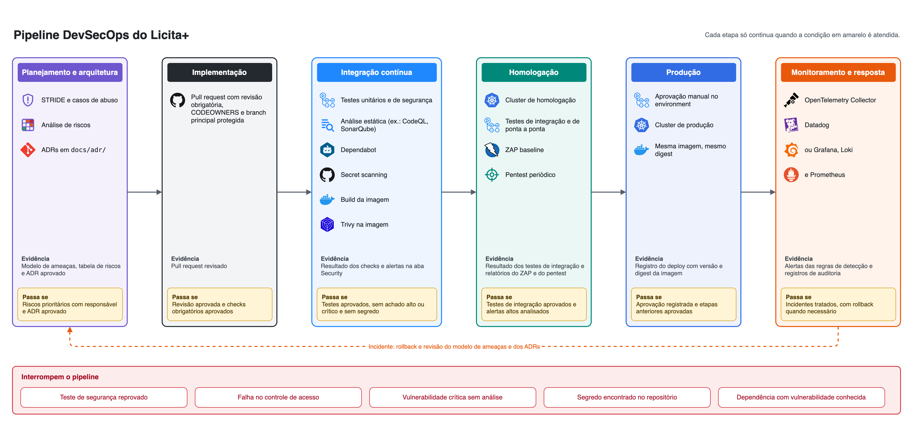

# Etapa 7: pipeline DevSecOps

Proposta de pipeline para o Licita+.

O arquivo editável do diagrama está em [pipeline-devsecops.drawio](../diagramas/etapa-7/pipeline-devsecops.drawio).

| Momento | Atividade de segurança | Evidência produzida | Condição para continuar |
| --- | --- | --- | --- |
| Planejamento | STRIDE, casos de abuso e análise de riscos, versionados no repositório | Modelo de ameaças e tabela de riscos atualizados no pull request | Riscos prioritários identificados e com responsável |
| Requisitos e arquitetura | Um ADR por decisão em `docs/adr/`. O `CODEOWNERS` exige revisão da segurança | ADR aprovado no pull request | Mudança em autenticação, autorização ou exposição de serviço só passa com ADR aprovado |
| Implementação | Pull request com revisão obrigatória e branch principal protegida | Pull request revisado | Revisão aprovada e checks obrigatórios aprovados |
| Testes automatizados | GitHub Actions roda os testes unitários e de segurança a cada pull request | Resultado dos testes no check | Todos os testes aprovados |
| Código e dependências | Ferramenta de análise estática (ex.: CodeQL, SonarQube), Dependabot, secret scanning do GitHub e Trivy na imagem Docker | Relatório da análise estática, alertas do Dependabot e do secret scanning e relatório do Trivy no check | Nenhum achado alto ou crítico aberto e nenhum segredo detectado |
| Teste dinâmico | Implantação da imagem no cluster de homologação, testes de integração e de ponta a ponta, ZAP baseline contra esse ambiente e pentest periódico | Resultado dos testes de integração, relatório do ZAP como artefato do workflow e relatório do pentest | Testes de integração aprovados e alertas altos analisados |
| Implantação | Promoção da mesma imagem para o cluster de produção, com aprovação manual no environment do GitHub | Registro do deploy com versão e digest da imagem | Aprovação registrada e momentos anteriores aprovados |
| Monitoramento e resposta | A aplicação exporta logs, métricas e traces por OpenTelemetry. O Collector no cluster de produção envia esses dados para o Datadog ou para Grafana, Loki e Prometheus, onde ficam as regras de detecção e os alertas | Alertas e registros de auditoria | Incidentes tratados, com rollback quando a versão nova causar a falha |

## Condições que interrompem o pipeline

1. Teste de segurança reprovado. O check de testes falha e o pull request não pode ser mesclado.
2. Falha no controle de acesso. Se um teste, o ZAP ou o pentest mostrar um usuário lendo ou alterando dados de outra empresa, ou executando uma operação fora do seu papel, a versão não é promovida para produção.
3. Vulnerabilidade crítica sem análise. Um achado alto ou crítico da análise estática ou do Trivy impede o merge. No ZAP, impede a promoção para produção.
4. Segredo encontrado no repositório. O pipeline para até a credencial ser removida e trocada.
5. Dependência com vulnerabilidade conhecida. Um alerta alto ou crítico do Dependabot bloqueia o merge até a atualização ou uma justificativa registrada.
